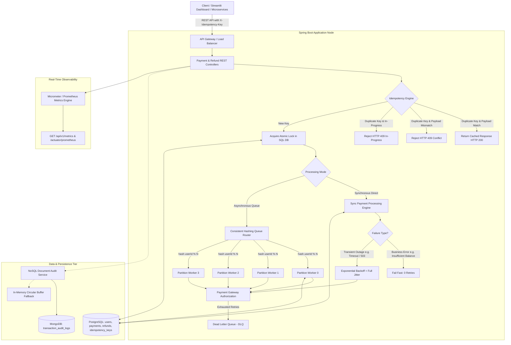

# ⚡ Distributed Fault-Tolerant Payment & Transaction Engine

[](https://github.com/Dhanya562004/distributed-fault-tolerant-payment-system)
[](https://www.oracle.com/java/)
[](https://spring.io/projects/spring-boot)
[](https://distributed-fault-tolerant-payment-system-5qg2tjnkfrk7tvbqxzsz.streamlit.app/)
[](docs/testing.md)
[](LICENSE)

An enterprise-grade, distributed, fault-tolerant **Payment & Transaction Engine** engineered with **Java 17 and Spring Boot 3.3**, modeled after high-throughput transaction processing systems at **Standard Chartered Bank**, Stripe, and PayPal. Designed for single-execution idempotency guarantees, fail-fast business error classification, exponential backoff retries with jitter, account-partitioned asynchronous worker queues, and polyglot persistence (PostgreSQL + MongoDB).

---

### 🌐 Live Interactive Cloud Control Room
👉 **[Launch Live Visual Control Room Dashboard](https://distributed-fault-tolerant-payment-system-5qg2tjnkfrk7tvbqxzsz.streamlit.app/)**  
*Hosted on Streamlit Community Cloud with Dual-Mode Architecture (supports live Spring Boot API binding and standalone in-memory visual simulation).*

---

## 🎮 Visual Control Room Features

The visual dashboard (`dashboard/app.py`) provides an interactive interface for exploring payment flows, partition worker concurrency, and system resilience.

### 1. 📊 Financial KPI & Velocity Telemetry
- **Gross Processed Volume (GPV)**: Calculates real-time settlement volume across multiple currencies (USD, EUR, GBP, INR) converted to USD equivalents.
- **Service Level Agreement (SLA) Success Rate**: Real-time gauge tracking transaction authorization rate against a strict 99.5% enterprise SLA target.
- **Zero-Double-Charge Idempotency Hits**: Tracks deduplication tokens, displaying duplicate requests intercepted and served from cache without duplicate ledger deductions.
- **P99 & Average Latency Telemetry**: Real-time measurement of end-to-end authorization times, including partition enqueueing and gateway execution.
- **Retries & Auto-Recoveries Counter**: Tracks automated retry cycles triggered by simulated downstream network glitches.

### 2. 🔍 Transaction Forensic Inspector & 1-Click Refunds
- **Multi-Rail Activity Feed**: Real-time transaction log with multi-criteria filtering by payment status (`SUCCESS`, `PENDING`, `FAILED`, `REFUNDED`), payment rail (Credit Card, Debit Card, UPI, Apple Pay, Bank Transfer, Wallet), currency, and customer account ID.
- **Deep Forensic Inspector**: Select any payment record to inspect its raw payload, cryptographic idempotency key, assigned partition worker shard, and timestamp down to the millisecond.
- **1-Click Refund Execution**: Instant refund issuance form pre-populated with transaction context, enforcing cumulative refund ceilings directly from the visual interface.

### 3. ⚙️ Partition Worker Cluster Matrix
- **Consistent Hashing Shard Distribution**: Visualizes work distribution across 4 dedicated consumer worker threads (`worker-partition-0` through `worker-partition-3`) based on `hash(userId) % 4`.
- **Worker Health & Concurrency Telemetry**: Real-time metrics for each shard showing assigned user affinity, active queue depth, and processed message count.
- **Resilience4j Circuit Breaker Telemetry**: Live status card monitoring the downstream banking gateway circuit breaker (`CLOSED`, `HALF-OPEN`, `OPEN`), sliding window failure rates (50% threshold), and auto-recovery wait durations.
- **Exponential Backoff Policy Inspector**: Visual breakdown of the retry configuration ($200\text{ms}$ base delay, $2.0\times$ multiplier, and randomized full jitter).

### 4. 🛡️ Defensive Chaos & Fault Injection Lab
- **Simulated Network Jitter & Latency**: Slider control injecting 500 ms to 5,000 ms delays into gateway calls to test client timeouts.
- **Socket Read Timeouts**: Configurable failure probability injecting simulated network drops.
- **503 Gateway Service Outages**: Probability slider triggering downstream banking outages to evaluate exponential backoff retry loops.
- **Database Lock Contention**: Injects simulated row-level lock collisions to verify pessimistic/optimistic lock handling.
- **Dead Letter Queue (DLQ) Inspector**: Inspects unrecoverable failed messages routed to the DLQ after exhausting all retry attempts.

### 5. 🔄 Dual-Engine Processing Architecture

The dashboard supports two operating modes via the **Target Processing Mode** radio selector:

```
┌─────────────────────────────────────────────────────────────────────────────┐
│                            Streamlit Dashboard                              │
└───────────────────────┬─────────────────────────────┬───────────────────────┘
                        │                             │
       [Mode: Force Live API]          [Mode: Standalone Simulation]
                        │                             │
                        ▼                             ▼
         ┌───────────────────────────┐ ┌───────────────────────────┐
         │  Live Spring Boot Engine  │ │ In-Memory Session Engine  │
         │  (http://localhost:8080)  │ │ (Streamlit Session State) │
         ├───────────────────────────┤ ├───────────────────────────┤
         │ • Real PostgreSQL/H2 DB   │ │ • Ephemeral mock data     │
         │ • Real Worker Threads     │ │ • In-memory state machine │
         │ • Real DB Idempotency     │ │ • Zero backend dependency │
         │ • Real Micrometer Metrics │ │ • Safe cloud demos        │
         └───────────────────────────┘ └───────────────────────────┘
```

> [!IMPORTANT]
> **Understanding Standalone Simulation Mode vs Live Mode:**
> - **Standalone Simulation Mode**: When the dashboard cannot reach a live Spring Boot backend (e.g. running on Streamlit Cloud without a public backend URL), it runs in an in-memory simulation mode. **Simulation metrics, transactions, and audit logs are generated in-memory within the browser session and are NOT real backend operations.** They do not touch a database, execute real Java worker threads, or persist after reload.
> - **Live Spring Boot API Mode**: When bound to a running Spring Boot instance (`http://localhost:8080` or a deployed HTTPS URL), every payment, refund, fault rule, and metric query is an **actual HTTP REST call** to the Java microservice, executing real database transactions and worker pool processing.

---

## 🛠️ Step-by-Step Execution Guide

### Option 1: Run Everything Locally (Full-Stack Live Execution)

Run both the Spring Boot backend and the Streamlit dashboard on your local machine so the dashboard communicates directly with the live Java engine over `localhost`.

#### Prerequisites
- **JDK 17+** (`java -version`)
- **Apache Maven 3.9+** (`mvn -version`)
- **Python 3.10+** (`python --version`)

#### Steps
1. **Start the Spring Boot backend:**
   ```bash
   # From repository root
   mvn spring-boot:run
   ```
2. **Confirm backend is running on port 8080:**
   Open your browser or run curl to verify health:
   ```bash
   curl http://localhost:8080/actuator/health
   # Expected response: {"status":"UP","components":{"db":{"status":"UP"...}}}
   ```
   Open Swagger UI: `http://localhost:8080/swagger-ui.html`

3. **Install dashboard dependencies & run Streamlit:**
   ```bash
   # In a separate terminal
   cd dashboard
   pip install -r requirements.txt
   streamlit run app.py
   ```
4. **Select Force Live Spring Boot API in Dashboard:**
   - Open `http://localhost:8501` in your browser.
   - In the left sidebar under **Target Processing Mode**, select **Force Live Spring Boot API** (or leave on **Auto-Detect**).
   - Ensure **Backend API Base URL** is set to `http://localhost:8080`.
5. **Verify live backend connection:**
   - The top banner will display: `🟢 LIVE SPRING BOOT ENGINE BOUND`.
   - The sidebar badge will show: `SPRING BOOT CONNECTED` (`Node: http://localhost:8080`).
   - Click **"🚀 Traffic Burst"** or submit payments through the **Payment Simulator** tab; observe transactions persisting to the backend and updating `/api/v1/metrics`.

---

### Option 2: Connect Deployed Streamlit Dashboard to a Live Backend

When using the hosted Streamlit Community Cloud instance ([Live Demo](https://distributed-fault-tolerant-payment-system-5qg2tjnkfrk7tvbqxzsz.streamlit.app/)), the cloud container cannot access `http://localhost:8080` on your local laptop because `localhost` resolves inside the cloud container. To connect the cloud dashboard to a live backend, provide a public HTTPS URL.

#### Method A: Expose Local Spring Boot via Free HTTPS Tunnel (Instant Testing)
1. Ensure your Spring Boot backend is running locally on port 8080 (`mvn spring-boot:run`).
2. Expose port 8080 to a public HTTPS endpoint using a tunnel tool:
   ```bash
   # Using localtunnel:
   npx localtunnel --port 8080
   # OR using ngrok:
   ngrok http 8080
   # OR using Cloudflare Tunnel:
   cloudflared tunnel --url http://localhost:8080
   ```
3. Copy the generated public HTTPS URL (e.g. `https://your-tunnel-subdomain.loca.lt` or `https://xyz.ngrok-free.app`).
4. Open the [Streamlit Cloud Dashboard](https://distributed-fault-tolerant-payment-system-5qg2tjnkfrk7tvbqxzsz.streamlit.app/).
5. Paste your public HTTPS URL into the **Backend API Base URL** field in the left sidebar.
6. Select **Force Live Spring Boot API**. The status will turn green (`🟢 LIVE SPRING BOOT ENGINE BOUND`), and your cloud dashboard will interact directly with your local Spring Boot backend.

#### Method B: Deploy Spring Boot Backend to a Cloud Provider
1. Deploy the Spring Boot application using the included [Dockerfile](Dockerfile) to any cloud host (e.g. Render, Railway, AWS ECS, Fly.io, or Heroku):
   - **Build Command**: `mvn clean package -DskipTests`
   - **Start Command**: `java -jar target/distributed-fault-tolerant-payment-system-1.0.0.jar`
   - **Exposed Port**: `8080`
2. Obtain your assigned public HTTPS URL (e.g. `https://<your-deployed-backend-url>`).
3. In your Streamlit Cloud app settings, configure the environment variable:
   ```env
   BACKEND_API_URL=https://<your-deployed-backend-url>
   ```
   *(Or simply enter the URL into the **Backend API Base URL** field in the dashboard sidebar).*
4. Select **Force Live Spring Boot API** in the sidebar. All transactions submitted from Streamlit Cloud will route to your live deployed backend.

---

## 📑 Engineering Documentation Suite

| Document | Purpose |
| :--- | :--- |
| 📊 **[Requirements Traceability Matrix](docs/requirements-matrix.md)** | Direct mapping to Standard Chartered Bank Development Engineer (Band 8) requirements (100% verified coverage). |
| 🏛️ **[System Architecture](docs/architecture.md)** | Deep-dive into distributed topology, concurrency models, partitioned queues, and retry loops. |
| ⚖️ **[Architectural Decision Records (ADRs)](docs/design-decisions.md)** | Rationale for SHA-256 payload digests, fail-fast error classification, and polyglot storage. |
| 🔌 **[REST API Guide](docs/api-guide.md)** | Complete HTTP endpoints, OpenAPI 3.0 schemas, headers, pagination, and error responses. |
| 🧪 **[Test Strategy & Verification](docs/testing.md)** | Verification evidence for 20 automated tests, concurrency stress test, and retry resilience. |
| 🎯 **[Technical Interview Preparation](docs/interview-preparation.md)** | 14 rigorous interview questions and concise code-backed architectural explanations. |
| 📝 **[Initial Codebase Audit](docs/initial-audit.md)** | Forensic analysis of baseline code, identified edge cases, and upgrade roadmap. |
| 📜 **[Development Log](docs/dev-log.md)** | Chronological log of changes, refactorings, and verification commands. |
| ✅ **[Final Verification Report](docs/final-verification.md)** | Exact build commands, execution times, test counts, and artifact confirmation. |

---

## 🏛️ System Architecture



---

## ⚙️ Core Engineering Capabilities

### 1. 🛡️ Absolute Idempotency & Payload Conflict Detection
- **Atomic Locks**: Evaluates `X-Idempotency-Key` using database-level `UNIQUE` constraints in PostgreSQL / H2.
- **SHA-256 Digest Verification**: Prevents key hijacking. If an idempotency key is reused with a different request payload, the engine rejects it immediately with `PayloadMismatchException` (HTTP 409 Conflict).
- **Concurrent In-Flight Protection**: Rejects concurrent requests using the same key with `DuplicateRequestException` (HTTP 409 Conflict).

### 2. 🔁 Intelligent Failure Taxonomy & Exponential Backoff
- **Fail-Fast Business Errors**: Non-retryable errors (`InsufficientBalanceException`, `PayloadMismatchException`, `InvalidTransactionStateException`) fail fast on Attempt 1 without wasting retries (`retryCount = 0`).
- **Resilient Retry Loop**: Transient failures (`GatewayTimeoutException`, `ServiceUnavailableException`, `LockAcquisitionException`) are retried up to 3 times with exponential backoff and randomized jitter:
  $$\text{Backoff} = \min\left(\text{Initial} \times 2^{\text{attempt}} + \text{rand}(0, 200\text{ms}), 8000\text{ms}\right)$$

### 3. 🔀 Account-Partitioned Asynchronous Worker Pools
- Uses consistent hashing on `userId` to route asynchronous payment requests to dedicated partition queues.
- Guarantees **strict per-user FIFO execution order** while allowing parallel multi-threaded throughput across distinct customer accounts.

### 4. 💸 Cumulative Refund Ceiling Validation
- Enforces multi-step refund limits:
  $$\sum \text{Existing Refunds} + \text{New Refund Amount} \le \text{Original Payment Amount}$$
- Prevents over-refunding and transitions payment status to `REFUNDED` upon full repayment.

### 5. 📜 Polyglot Persistence Strategy
- **PostgreSQL / H2**: Relational ACID transactional storage with `@Version` optimistic locking, row constraints, foreign keys, and indexes.
- **MongoDB**: High-throughput, append-only document audit log (`AuditLogDocument`) with in-memory non-blocking circular fallback queue when MongoDB is disabled.

---

## 🔌 REST API Specification

| HTTP Method | Endpoint | Parameters / Headers | Description |
| :--- | :--- | :--- | :--- |
| `POST` | `/api/v1/payments` | `X-Idempotency-Key` | Initiate synchronous or asynchronous payment transaction |
| `GET` | `/api/v1/payments/{paymentId}` | `paymentId` (Path) | Query payment status and details |
| `GET` | `/api/v1/payments` | `page`, `size` (Query) | List payment records with pagination |
| `GET` | `/api/v1/payments/user/{userId}` | `userId` (Path), `page`, `size` | List user payment records with pagination |
| `POST` | `/api/v1/refunds` | `X-Idempotency-Key` | Process refund and restore user account balance |
| `GET` | `/api/v1/refunds/{refundId}` | `refundId` (Path) | Query refund record details |
| `GET` | `/api/v1/refunds/payment/{paymentId}` | `paymentId` (Path) | Query all refunds for a specific payment |
| `POST` | `/api/v1/users` | JSON Payload | Register a new user account with starting balance |
| `GET` | `/api/v1/users/{userId}` | `userId` (Path) | Retrieve user balance and account details |
| `GET` | `/api/v1/audit/logs` | None | Query immutable document state transition audit trail |
| `GET` | `/api/v1/metrics` | None | Real-time Prometheus/Micrometer throughput, retries & latency |
| `POST` | `/api/v1/simulation/config` | JSON Payload | Inject simulated latency, socket timeouts, 503 gateway errors |
| `POST` | `/api/v1/simulation/reset` | None | Reset fault simulation lab to clean defaults |
| `GET` | `/api/v1/simulation/dlq` | None | Inspect unrecoverable messages in Dead Letter Queue |

---

## 🧪 Automated Testing & Concurrency Evidence

The test suite validates correctness under heavy contention and edge cases:

- **20 Automated Tests Executed**: 20 Passed, 0 Failures, 0 Errors.
- **Multi-Threaded Stress Test (`ConcurrentPaymentTest`)**: 10 parallel threads contending for the same idempotency key simultaneously:
  - **Result**: Exactly 1 thread successfully acquired the atomic lock and processed the transaction.
  - **Result**: 9 threads encountered managed lock conflicts and were gracefully rejected without side effects.
  - **Result**: User balance deducted **exactly once** ($1,000 -> $900). Zero double-spending.
- **Fail-Fast Verification (`PaymentProcessingServiceTest`)**: Insufficient account balance fails on Attempt 1 with 0 retries.
- **Payload Conflict Verification (`IdempotencyServiceTest`)**: Same key with different payload triggers HTTP 409 Conflict.
- **Cumulative Refund Limits (`RefundProcessingServiceTest`)**: Multiple refunds totaling more than transaction amount rejected with HTTP 422.
- **End-to-End Lifecycle (`PaymentLifecycleIntegrationTest`)**: Full lifecycle verified in Spring Boot test container.

```bash
mvn clean test
```

---

## ⚠️ Known Limitations & Operational Boundaries

1. **Network Boundary for Streamlit Community Cloud**:
   - Streamlit Community Cloud instances run on remote cloud infrastructure and cannot resolve `http://localhost:8080` on your workstation. Connecting the cloud dashboard to a live backend requires a public HTTPS URL (via tunnel or cloud hosting, as detailed in Option 2).
2. **Ephemeral Standalone Mode**:
   - When running in Standalone Simulation Mode, all state is held in Python `st.session_state`. Refreshing the browser or starting a new session resets simulation data back to initial seeds.
3. **In-Memory Audit Fallback in Dev Profile**:
   - In the `dev` Spring Boot profile, MongoDB auto-configuration is excluded by default for ease of local evaluation. Audit logs are persisted to an in-memory thread-safe circular buffer (`ConcurrentLinkedQueue`) instead of a physical MongoDB instance. Enabling physical MongoDB persistence is activated in `application-prod.yml`.

---

## 🤝 License
Distributed under the **Apache 2.0 License**. Reference implementation for distributed transaction processing.
