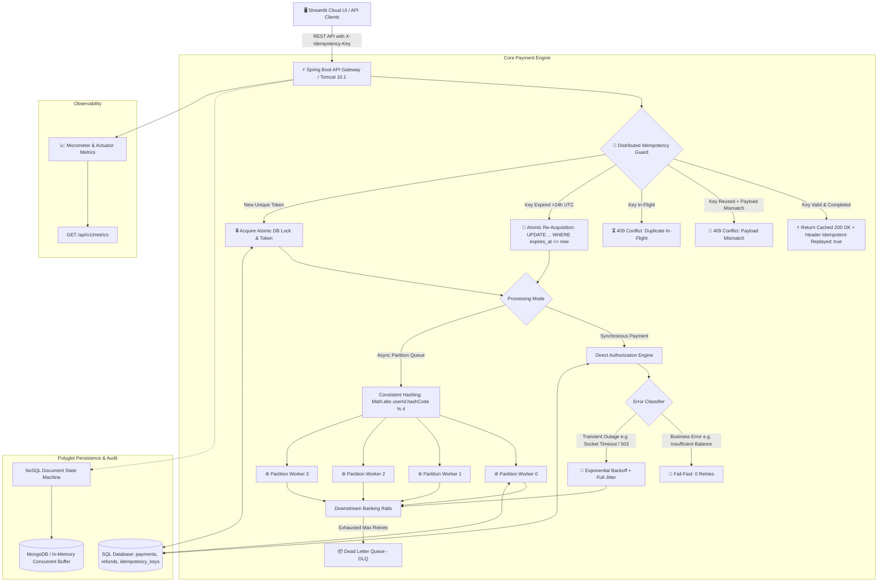

# ⚡ ApexPay | Distributed Fault-Tolerant Payment Engine

<div align="center">

[](https://distributed-fault-tolerant-payment-system-5qg2tjnkfrk7tvbqxzsz.streamlit.app/)
[](https://apexpay-backend-sc5s.onrender.com/actuator/health)
[](https://apexpay-backend-sc5s.onrender.com/swagger-ui.html)

[](https://www.oracle.com/java/)
[](https://spring.io/projects/spring-boot)
[](Dockerfile)
[](docs/architecture.md)
[-10B981.svg?style=flat-square&logo=checkmarx)](docs/testing.md)
[](LICENSE)

<p align="center">
  <b>A Production-Grade, Resilient Transaction Processing Engine modeled after tier-1 banking systems at Standard Chartered Bank, Stripe, and PayPal.</b><br>
  Built with <b>Java 17, Spring Boot 3.3, and Python Streamlit</b> featuring <b>distributed cryptographic idempotency</b>, <b>24-hour retention expiry</b>, <b>Idempotent-Replayed HTTP headers</b>, <b>Transactional Outbox Pattern & Reliable Webhook Engine</b>, <b>deterministic cursor-based keyset pagination</b>, <b>account-partitioned concurrency queues</b>, <b>exponential backoff with full jitter</b>, <b>fail-fast failure classification</b>, and <b>immutable NoSQL audit trails</b>.
</p>

[🎮 Launch Cloud Control Room](https://distributed-fault-tolerant-payment-system-5qg2tjnkfrk7tvbqxzsz.streamlit.app/) • [🔌 Explore OpenAPI Specification](https://apexpay-backend-sc5s.onrender.com/swagger-ui.html) • [📑 Engineering Docs Suite](#-engineering-documentation-suite)

</div>

---

## 🌟 Instant Cloud Live Deployment

| Service | Endpoint / Link | Status & Purpose |
| :--- | :--- | :--- |
| 🖥️ **Streamlit Cloud Dashboard** | [distributed-fault-tolerant-payment-system.streamlit.app](https://distributed-fault-tolerant-payment-system-5qg2tjnkfrk7tvbqxzsz.streamlit.app/) | **Live Interactive Control Room** with real-time KPI metrics, forensic transaction inspector, and fault injection lab. |
| ⚡ **Render Production Microservice** | [`https://apexpay-backend-sc5s.onrender.com`](https://apexpay-backend-sc5s.onrender.com/actuator/health) | **High-Throughput Spring Boot 3.3 Cluster** with Actuator health, partitioned workers, and in-memory/Postgres persistence. |
| 📖 **Swagger OpenAPI 3.0 Interactive Docs** | [`https://apexpay-backend-sc5s.onrender.com/swagger-ui.html`](https://apexpay-backend-sc5s.onrender.com/swagger-ui.html) | Direct interactive browser interface for executing live payment and refund REST API payloads. |
| 📊 **Live Telemetry Actuator** | [`/api/v1/metrics`](https://apexpay-backend-sc5s.onrender.com/api/v1/metrics) | Real-time Micrometer/Prometheus telemetry stream tracking throughput, retries, latency, and idempotency hits. |

---

## 🏛️ High-Level Distributed Architecture



---

## 🎮 Interactive Visual Control Room Features

The visual dashboard ([`dashboard/app.py`](dashboard/app.py)) connects out-of-the-box to the live Render backend, providing comprehensive insight into transaction lifecycles:

### 1. 📊 Executive Financial & Velocity Telemetry
- **Gross Processed Volume (GPV)**: Calculates real-time settlement volume across global currencies (USD, EUR, GBP, INR) converted to USD equivalents.
- **SLA Success Rate Gauge**: Tracks gateway authorization rate against a strict enterprise 99.5% SLA target.
- **Zero-Double-Charge Idempotency Hits**: Real-time counter of duplicate requests intercepted and served from cache without duplicate deductions.
- **P99 & Average Latency Tracker**: Live measurement of end-to-end authorization times, including partition queue overhead.
- **Auto-Recovered Glitch Retries**: Live counter showing automatic retry loops recovered via exponential backoff.

### 2. 🔍 Forensic Transaction Inspector & Smart 1-Click Refunds
- **Multi-Rail Activity Ledger**: Live filterable ledger supporting Credit Cards, Debit Cards, UPI, Apple Pay, Bank Transfers, and Digital Wallets.
- **Deep Forensic Inspector**: Click any transaction to inspect its idempotency tokens, partition shard affinity, order metadata, and exact failure reason.
- **Smart Refund Dropdown with Client Validation Guard**:
  - Dynamically populates eligible `SUCCESS` payment records with their exact amount and account.
  - Automatically pre-fills `Target Payment ID` and `Refund Amount`.
  - Client-side validation ensures no blank or invalid payment IDs reach the backend, preventing HTTP 400 validation failures.
  - Enforces cumulative refund ceilings ($\sum \text{Refunds} \le \text{Payment Amount}$).

### 3. ⚙️ Partition Worker Concurrency Matrix
- **Consistent Hash Partitioning**: Visualizes multi-threaded worker pools (`worker-partition-0` to `worker-partition-3`) using Java's exact `Math.abs(userId.hashCode()) % 4` algorithm.
- **Per-Account FIFO Ordering**: Prevents out-of-order execution on single customer accounts while maximizing parallel throughput across distinct users.
- **Resilience4j Circuit Breaker Telemetry**: Live status card monitoring the downstream banking gateway circuit breaker (`CLOSED`, `HALF-OPEN`, `OPEN`), 50% failure rate thresholds, and auto-recovery durations.

### 4. 🛡️ Chaos Engineering & Fault Injection Lab
- **Network Latency Jitter**: Sliders to inject between 500 ms and 5,000 ms delays into banking calls to test client timeouts.
- **Socket Read Timeouts**: Configurable failure probability simulating socket read interruptions.
- **503 Gateway Service Outages**: Tests exponential backoff recovery loops under severe downstream service degradation.
- **Dead Letter Queue (DLQ) Inspector**: Live inspection of unrecoverable messages routed to the DLQ after exhausting 3 backoff retries.

---

## ⚙️ Core Engineering Capabilities

### 1. 🛡️ Cryptographic Idempotency, 24-Hour Expiry & Replay Guard
- **Atomic SQL Token Locks**: Evaluates `X-Idempotency-Key` using database-level `UNIQUE` constraints in PostgreSQL / H2.
- **24-Hour Retention Period**: Idempotency keys have a configurable 24-hour retention period (`app.idempotency.retention-hours: 24`). Re-submitting an identical request within this window returns the cached response.
- **`Idempotent-Replayed: true` Response Header**: When a completed payment or refund is served from the idempotency cache, the HTTP response includes `Idempotent-Replayed: true`. Original payment executions do NOT return this header.
- **Atomic Expired-Key Reuse**: Once a key passes its 24-hour UTC expiry boundary, clients can safely reuse the key for a fresh payment. An atomic conditional update (`UPDATE ... WHERE expires_at <= :now`) with PostgreSQL row-level locks guarantees that concurrent requests reusing an expired key cannot double-charge.
- **SHA-256 Digest Verification**: Prevents key tampering. Reusing an unexpired key with a modified payload triggers an immediate `PayloadMismatchException` (HTTP 409 Conflict) without a replay header.
- **In-Flight Lock Protection**: Rejects concurrent in-flight requests for the same key with `DuplicateRequestException` (HTTP 409 Conflict).
- **Safe Background Expiration Cleanup**: Scheduled hourly cron task (`cleanupExpiredKeys`) purges expired tokens while strictly preserving active (`IN_PROGRESS`) transactions, payment records, and immutable audit trails.

### 2. 🔁 Intelligent Failure Taxonomy & Exponential Backoff
- **Fail-Fast Business Errors**: Non-retryable errors (`InsufficientBalanceException`, `PayloadMismatchException`, `InvalidTransactionStateException`) fail fast on Attempt 1 with zero retries.
- **Resilient Retry Loop**: Transient failures (`GatewayTimeoutException`, `ServiceUnavailableException`, `LockAcquisitionException`) are retried up to 3 times with exponential backoff and randomized jitter:
  $$\text{Backoff} = \min\left(\text{Initial} \times 2^{\text{attempt}} + \text{rand}(0, 200\text{ms}), 8000\text{ms}\right)$$

### 3. 🔀 Account-Partitioned Concurrency Queues
- Uses consistent hashing on `userId` to route asynchronous payment requests to dedicated partition queues.
- Guarantees **strict per-user FIFO execution order** without race conditions, while allowing parallel multi-threaded throughput across independent user accounts.

### 4. 💸 Cumulative Refund Ceiling Validation
- Enforces multi-step refund limits:
  $$\sum \text{Existing Refunds} + \text{New Refund Amount} \le \text{Original Payment Amount}$$
- Prevents over-refunding and transitions payment status to `REFUNDED` upon full repayment.

### 5. 📜 Polyglot Persistence Strategy
- **PostgreSQL / H2**: Relational ACID transactional storage with `@Version` optimistic locking, row constraints, foreign keys, and indexes.
- **MongoDB**: High-throughput, append-only document audit log (`AuditLogDocument`) with thread-safe in-memory circular buffer fallback.

---

## 🔌 REST API Specification

| HTTP Method | Endpoint | Parameters / Headers | Description |
| :--- | :--- | :--- | :--- |
| `POST` | `/api/v1/payments` | `X-Idempotency-Key` (Optional Header) | Initiate synchronous or partitioned asynchronous payment. Cached replays return `Idempotent-Replayed: true` |
| `GET` | `/api/v1/payments/{paymentId}` | `paymentId` (Path) | Query payment status, metadata, and retry count |
| `GET` | `/api/v1/payments` | `page`, `size` (Query) | List payment records with pagination |
| `GET` | `/api/v1/payments/user/{userId}` | `userId` (Path), `page`, `size` | List all payment transactions for a specific user |
| `POST` | `/api/v1/refunds` | `X-Idempotency-Key` (Optional Header) | Process refund with cumulative ceiling checks. Cached replays return `Idempotent-Replayed: true` |
| `GET` | `/api/v1/refunds/{refundId}` | `refundId` (Path) | Query refund record details |
| `GET` | `/api/v1/refunds/payment/{paymentId}` | `paymentId` (Path) | Query all refunds associated with a payment |
| `POST` | `/api/v1/users` | JSON Payload | Register a new user account with starting balance |
| `GET` | `/api/v1/users/{userId}` | `userId` (Path) | Retrieve user balance and account details |
| `GET` | `/api/v1/audit/logs` | None | Query immutable document state transition audit trail |
| `GET` | `/api/v1/metrics` | None | Real-time Prometheus/Micrometer throughput, retries & latency |
| `POST` | `/api/v1/simulation/config` | JSON Payload | Configure fault injection lab rules (latency, 503, timeouts) |
| `POST` | `/api/v1/simulation/reset` | None | Reset fault simulation lab to clean defaults |
| `GET` | `/api/v1/simulation/dlq` | None | Inspect unrecoverable messages routed to Dead Letter Queue |

---

## 🚀 Quickstart Guide

### Option A: Use the Hosted Cloud System (Zero Setup)
1. Open the [Live Streamlit Control Room](https://distributed-fault-tolerant-payment-system-5qg2tjnkfrk7tvbqxzsz.streamlit.app/).
2. The dashboard automatically connects to the production Render backend (`https://apexpay-backend-sc5s.onrender.com`).
3. Click **"🚀 Traffic Burst"** to inject transactions, test idempotency tokens, and execute instant refunds!

---

### Option B: Run Locally on Your Workstation

#### Prerequisites
- **JDK 17+** (`java -version`)
- **Apache Maven 3.9+** (`mvn -version`)
- **Python 3.10+** (`python --version`)

#### 1. Start the Spring Boot Backend
```bash
# Clone the repository
git clone https://github.com/Dhanya562004/distributed-fault-tolerant-payment-system.git
cd distributed-fault-tolerant-payment-system

# Run Spring Boot (In-Memory PostgreSQL-Compatible H2 mode)
mvn spring-boot:run
```
*Backend starts on `http://localhost:8080`. Verify health at `http://localhost:8080/actuator/health`.*

#### 2. Start the Streamlit Dashboard
```bash
# In a separate terminal
cd dashboard
pip install -r requirements.txt
streamlit run app.py
```
*Open `http://localhost:8501`. Enter `http://localhost:8080` in the sidebar to bind to your local engine.*

---

### Option C: Run Multi-Container Architecture via Docker Compose
```bash
docker-compose up --build
```
This provisions:
- `payment-backend-api` on port `8080`
- `payment-postgres-db` on port `5432`
- `payment-mongo-db` on port `27017`
- `payment-streamlit-dashboard` on port `8501`

---

## 🧪 Automated Testing & Verification Evidence

The test suite validates correctness under heavy contention and failure scenarios:

- **51 Automated Tests**: **51 Passed, 0 Failures, 0 Errors** (100% Pass Rate across 38 Fast H2 + 13 PostgreSQL 16 Testcontainers tests).
- **1,000-Request Concurrency Stress Benchmark (`ConcurrentPaymentTest`)**:
  - **Objective**: Flood the payment engine with 1,000 concurrent duplicate payment requests sharing the exact same idempotency key and payload to verify zero double-spending, atomic locks, and idempotency guarantees under extreme contention.
  - **Concurrency Model**: Bounded `ExecutorService` configured with 50 worker threads coordinated via a `CountDownLatch` dual-barrier (`readyLatch` and `startLatch`) to ensure simultaneous worker contention.
  - **Verification Commands**:
    ```bash
    # Run the 1,000-request concurrency benchmark independently
    mvn test -Dtest=ConcurrentPaymentTest

    # Run the complete test suite
    mvn clean test
    ```
  - **Repeatable Benchmark Results (3 Isolated Runs)**:
    | Run | Requests | Workers | Throughput | Total Time | Avg Latency | p50 (Median) | p95 Latency | p99 Latency | Original Charges | Cached / 409 Conflicts | Failures |
    | :---: | :---: | :---: | :---: | :---: | :---: | :---: | :---: | :---: | :---: | :---: | :---: |
    | **#1** | 1,000 | 50 | **554.7 req/s** | 1,802.7 ms | 87.744 ms | 6.789 ms | 629.064 ms | 1,708.116 ms | **1** | 999 | **0** |
    | **#2** | 1,000 | 50 | **902.9 req/s** | 1,107.6 ms | 48.808 ms | 4.274 ms | 344.781 ms | 377.274 ms | **1** | 999 | **0** |
    | **#3** | 1,000 | 50 | **1,527.6 req/s** | 654.6 ms | 28.120 ms | 2.062 ms | 166.966 ms | 404.663 ms | **1** | 999 | **0** |
  - **Database Correctness Assertions**:
    - **Persisted Payment Records**: Exactly **1** payment record persisted with status `SUCCESS`.
    - **Balance Deductions**: User balance deducted **exactly once** ($1,000.00 $\rightarrow$ $900.00). **Zero double-spending**.
    - **Idempotency Consistency**: Exactly **1** idempotency record in state `COMPLETED` storing HTTP 200 and cached response payload.
    - **Unexpected Failures**: Exactly **0** unexpected errors across all 3,000 requests.
  - **Known Limitations & Scope**:
    - **Service-Level Benchmark**: Invokes `PaymentProcessingService.initiatePayment()` directly in-process; does not measure HTTP/Tomcat serialization or network overhead.
- **PostgreSQL 16 Testcontainers Integration & Locking Suite (`com.paymentsystem.postgres.*`)**:
  - **Why Real PostgreSQL Testing**: In-memory H2 emulates PostgreSQL syntax but uses different concurrency semantics, table-level/coarse locking, and zero network socket I/O. Real PostgreSQL 16 testing via Testcontainers validates authentic multi-version concurrency control (MVCC), row-level locks, and transaction isolation.
  - **Docker-Free Local Development**: The local test suite (`mvn clean test`) excludes Testcontainers and runs the 38 fast H2 tests in ~3 seconds with zero Docker requirement.
  - **GitHub Actions Execution**: Automated 2-stage CI pipeline executes fast H2 tests first (Stage A) followed by the PostgreSQL 16 Testcontainers suite on Ubuntu runners with Docker pre-installed (Stage B).
  - **PostgreSQL Test Suites**:
    1. **Idempotency & Replay Invariants (`PostgreSqlIdempotencyTest`)**:
       - Validates atomic insert on unique constraint, in-progress HTTP 409 conflict, cached replay return, payload mismatch rejection, and concurrent duplicate prevention.
       - Validates 24-hour expired key atomic reuse and concurrent expired-key reuse prevention of double-charge via row-level locks.
    2. **Optimistic Locking Verification (`PostgreSqlOptimisticLockingTest`)**:
       - Validates JPA `@Version` on `User` (`version`) and `PaymentTransaction` (`lock_version`).
       - Stale entity update triggers genuine `OptimisticLockingFailureException` and preserves database consistency.
    3. **Pessimistic Row-Level Locking Verification (`PostgreSqlPessimisticLockingTest`)**:
       - Validates `@Lock(LockModeType.PESSIMISTIC_WRITE)` (`SELECT FOR UPDATE`) on `UserRepository.findByUserCodeForUpdate()` and `PaymentTransactionRepository.findByPaymentIdForUpdate()`.
       - Proves competing transactions are blocked at the database level by PostgreSQL's lock manager until the lock-holding transaction commits.
    4. **1,000-Request Concurrency Stress Benchmark (`PostgreSqlConcurrencyStressTest`)**:
       - Exercises the 1,000 duplicate request benchmark against real PostgreSQL 16 across 50 worker threads and 3 isolated runs.
  - **Commands**:
    ```bash
    # Run fast H2 test suite locally (Zero Docker required)
    mvn clean test

    # Run PostgreSQL 16 Testcontainers suite (Requires Docker / executed in GitHub Actions)
    mvn test -Ppostgres-it
    ```
- **Fail-Fast Verification (`PaymentProcessingServiceTest`)**: Insufficient account balance fails on Attempt 1 with 0 retries.
- **Payload Conflict Verification (`IdempotencyServiceTest`)**: Same key with different payload triggers HTTP 409 Conflict (`PayloadMismatchException`).
- **Cumulative Refund Limits (`RefundProcessingServiceTest`)**: Multiple refunds totaling more than transaction amount rejected with HTTP 422.
- **End-to-End Lifecycle (`PaymentLifecycleIntegrationTest`)**: Full lifecycle verified in Spring Boot test container.

---

## 📑 Engineering Documentation Suite

| Document | Purpose |
| :--- | :--- |
| 📊 **[Requirements Traceability Matrix](docs/requirements-matrix.md)** | Direct mapping to Standard Chartered Bank Development Engineer (Band 8) requirements (100% verified coverage). |
| 🏛️ **[System Architecture](docs/architecture.md)** | Deep-dive into distributed topology, concurrency models, partitioned queues, and retry loops. |
| 🪝 **[Webhook & Outbox Engine](docs/webhooks.md)** | Complete specification for Transactional Outbox, HMAC-SHA256 signatures, backoff, DLQ, and crash recovery. |
| 📄 **[Keyset Pagination Specification](docs/pagination.md)** | Production keyset cursor pagination with composite ordering, HMAC-SHA256 signatures, filter binding, and $O(1)$ SQL optimization. |
| ⚖️ **[Architectural Decision Records (ADRs)](docs/design-decisions.md)** | Rationale for SHA-256 payload digests, fail-fast error classification, and polyglot storage. |
| 🔌 **[REST API Guide](docs/api-guide.md)** | Complete HTTP endpoints, OpenAPI 3.0 schemas, headers, pagination, and error responses. |
| 🧪 **[Test Strategy & Verification](docs/testing.md)** | Verification evidence for 101 automated tests (78 Fast H2 + 23 PostgreSQL 16 Testcontainers), concurrency stress benchmarks, and locking mechanisms. |
| 🎯 **[Technical Interview Preparation](docs/interview-preparation.md)** | 14 rigorous interview questions and concise code-backed architectural explanations. |
| 📝 **[Initial Codebase Audit](docs/initial-audit.md)** | Forensic analysis of baseline code, identified edge cases, and upgrade roadmap. |
| 📜 **[Development Log](docs/dev-log.md)** | Chronological log of changes, refactorings, and verification commands. |
| ✅ **[Final Verification Report](docs/final-verification.md)** | Exact build commands, execution times, test counts, and artifact confirmation. |

---

## 🤝 License & Attribution

Distributed under the **Apache 2.0 License**. See [LICENSE](LICENSE) for details.  
Engineered as an enterprise reference implementation for resilient, distributed fintech systems.
