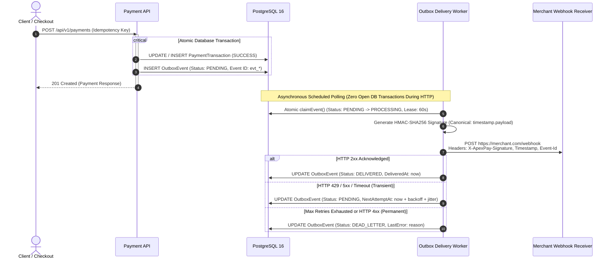

# ApexPay Webhook Delivery & Transactional Outbox Engine

## Overview & Architecture

In mission-critical payment processing systems, guaranteeing that external merchants receive accurate, timely, and tamper-proof notifications of payment and refund state transitions is essential. 

A naive approach—such as dispatching an HTTP POST request directly inside the payment transaction boundary—suffers from catastrophic failure modes:
1. **Network Delays & Connection Pool Exhaustion:** If the receiver's server is slow, open database connections remain held during network I/O, quickly exhausting thread and database connection pools.
2. **Dual-Write Vulnerability / Atomicity Loss:** If the HTTP request succeeds but the database transaction subsequently rolls back (or vice versa), the external merchant and internal database fall permanently out of sync.
3. **Lost Notifications on App Crashes:** If the application terminates after database commit but before dispatching the HTTP call, the notification is permanently lost.

ApexPay solves these fundamental distributed systems challenges using the **Transactional Outbox Pattern**:



---

## Webhook Event Types

ApexPay emits durable outbox events only for business transitions that are successfully committed to the database:

| Event Type | Aggregate | Trigger Condition |
| :--- | :--- | :--- |
| `payment.succeeded` | Payment ID (`PAY_*`) | Payment authorized and captured. Balance deducted from user account. |
| `payment.failed` | Payment ID (`PAY_*`) | Payment terminal failure (insufficient balance or gateway failure). |
| `refund.succeeded` | Refund ID (`REF_*`) | Refund processed. Account balance credited. |
| `refund.failed` | Refund ID (`REF_*`) | Terminal refund failure recorded in transaction boundary. |

> [!NOTE]
> Idempotent request replays returning cached responses never create duplicate outbox events. Only fresh, committed state transitions produce outbox events.

---

## Example Webhook Payload

Every outgoing webhook request carries a JSON payload with a stable, unique `eventId`:

```json
{
  "eventId": "evt_5f187a21394c489ba12de890f1234567",
  "eventType": "payment.succeeded",
  "aggregateId": "PAY_39B89463436A4CA2",
  "timestamp": "2026-10-19T10:42:00Z",
  "data": {
    "paymentId": "PAY_39B89463436A4CA2",
    "idempotencyKey": "IDEM_CHECKOUT_9921",
    "userId": "USR_ALICE",
    "amount": 250.00,
    "currency": "USD",
    "status": "SUCCESS",
    "paymentMethod": "CREDIT_CARD",
    "description": "Premium Subscription Tier",
    "failureReason": null,
    "retryCount": 0,
    "createdAt": "2026-10-19T10:41:58Z"
  }
}
```

---

## HMAC-SHA256 Signature Specification

To guarantee authenticity and protect against payload tampering, impersonation, and replay attacks, ApexPay signs every outgoing webhook HTTP request using HMAC-SHA256 with a merchant signing secret.

### HTTP Headers

Every dispatch includes three signature headers:

| Header Name | Description | Example |
| :--- | :--- | :--- |
| `X-ApexPay-Event-Id` | Stable unique event identifier across all retries | `evt_5f187a21394c489ba12de890f1234567` |
| `X-ApexPay-Timestamp` | Unix epoch timestamp (in seconds) of this delivery attempt | `1792406520` |
| `X-ApexPay-Signature` | Versioned HMAC-SHA256 hex digest (`v1=...`) | `v1=a3f9104058d88c42...` |

### Canonical Signing Algorithm

1. Extract the integer UTC epoch second timestamp: `timestamp`.
2. Extract the exact raw UTF-8 request body bytes: `rawPayload`.
3. Concatenate using period (`.`): `canonicalString = timestamp + "." + rawPayload`.
4. Calculate HMAC-SHA256 using `app.webhook.signing-secret`:
   $$\text{HMAC} = \text{HmacSHA256}(\text{canonicalString}, \text{secret})$$
5. Hex-encode the output and prefix with `v1=`:
   $$\text{Signature} = \text{"v1="} + \text{HexEncode}(\text{HMAC})$$

> [!IMPORTANT]
> A fresh timestamp and signature are calculated on each delivery attempt. The `eventId` and payload remain stable across all retries.

### Receiver Verification Implementation (Java Sample)

```java
public boolean verifyApexPayWebhook(String rawPayload, String signatureHeader, String timestampHeader, String signingSecret) {
    if (rawPayload == null || signatureHeader == null || timestampHeader == null || signingSecret == null) {
        return false;
    }

    // 1. Check timestamp tolerance (default: 300 seconds)
    long timestamp = Long.parseLong(timestampHeader.trim());
    long currentEpoch = Instant.now().getEpochSecond();
    if (Math.abs(currentEpoch - timestamp) > 300) {
        return false; // Replay attack or excessive clock skew
    }

    // 2. Compute expected HMAC
    String canonicalMessage = timestampHeader + "." + rawPayload;
    Mac mac = Mac.getInstance("HmacSHA256");
    mac.init(new SecretKeySpec(signingSecret.getBytes(StandardCharsets.UTF_8), "HmacSHA256"));
    byte[] hmac = mac.doFinal(canonicalMessage.getBytes(StandardCharsets.UTF_8));
    String expected = "v1=" + HexFormat.of().formatHex(hmac);

    // 3. Constant-time comparison to prevent timing side-channel attacks
    return MessageDigest.isEqual(
        expected.getBytes(StandardCharsets.UTF_8),
        signatureHeader.getBytes(StandardCharsets.UTF_8)
    );
}
```

---

## Exponential Backoff with Jitter

When a webhook destination responds with a transient failure, the delivery worker automatically schedules a retry with exponential backoff and random jitter:

### Failure Classification Policy

- **Retryable Errors:**
  - HTTP `429 Too Many Requests`
  - HTTP `500 Internal Server Error`
  - HTTP `502 Bad Gateway`
  - HTTP `503 Service Unavailable`
  - HTTP `504 Gateway Timeout`
  - Socket Timeouts, Connection Timeouts, and Network I/O failures
- **Non-Retryable (Permanent) Errors:**
  - HTTP `400 Bad Request`
  - HTTP `401 Unauthorized`
  - HTTP `403 Forbidden`
  - HTTP `404 Not Found`
  - HTTP `422 Unprocessable Entity`
  - SSRF block / Invalid URL format
  *Permanent errors immediately transition the event to `DEAD_LETTER`.*

### Backoff Formula

$$\text{delay} = \min\left(\text{maxDelay}, \text{baseDelay} \times 2^{(\text{attempt} - 1)}\right) + \text{jitter}$$

where $\text{jitter} \in [0, 0.25 \times \text{delay}]$.

| Attempt | Base Delay | Multiplier | Calculated Delay Window |
| :---: | :---: | :---: | :---: |
| 1 | 1,000 ms | $2^0 = 1$ | 1,000 ms – 1,250 ms |
| 2 | 1,000 ms | $2^1 = 2$ | 2,000 ms – 2,500 ms |
| 3 | 1,000 ms | $2^2 = 4$ | 4,000 ms – 5,000 ms |
| 4 | 1,000 ms | $2^3 = 8$ | 8,000 ms – 10,000 ms |
| 5 | 1,000 ms | $2^4 = 16$ | 16,000 ms – 20,000 ms |
| **Max Cap** | — | — | **300,000 ms (5 minutes)** |

---

## Dead-Letter Queue (DLQ) & Manual Redelivery

When an event exceeds `maxAttempts` (default: 5) or encounters a non-retryable error, it transitions to `DEAD_LETTER`.

- Failed events are **never deleted**.
- All metadata (`eventId`, `aggregateId`, `payload`, `attemptCount`, `lastError`, `createdAt`) is permanently preserved.
- Webhook failure has **zero impact** on the committed payment state.

### Manual Redelivery

Operators can trigger manual redelivery programmatically via `WebhookDeliveryService.redeliverDeadLetterEvent(eventId)`.
- Atomically resets status to `PENDING` and `attemptCount` to `0`.
- **Reuses the original `eventId`** to preserve receiver deduplication integrity.
- Atomic conditional update prevents concurrent redelivery race conditions.

---

## Concurrency, Crash Recovery & Lease Management

1. **Mutual Exclusion via Atomic Claiming:**
   ```sql
   UPDATE outbox_events
   SET status = 'PROCESSING', lease_owner = :workerId, locked_until = :leaseUntil, updated_at = :now
   WHERE id = :id AND (status = 'PENDING' OR (status = 'PROCESSING' AND locked_until < :now));
   ```
   If 20 worker threads attempt to claim the same event simultaneously, PostgreSQL and H2 guarantee that exactly 1 succeeds (`rows_updated = 1`) and 19 fail safely (`rows_updated = 0`).

2. **Worker Crash Recovery (Lease Expiry):**
   If a worker JVM crashes while an HTTP request is in-flight, the event remains in `PROCESSING` with `locked_until = now + 60s`. Once `locked_until < now`, any surviving worker detects the expired lease and safely reclaims the event.

3. **No Database Transactions During HTTP Calls:**
   Database transactions are only opened for microseconds during claim and status updates. No connections are held during external HTTP requests.

---

## SSRF Security Hardening

ApexPay enforces strict destination URL validation:
- **HTTPS Enforcement:** Production requires `https://`.
- **Blocked Subnets:** Rejects `localhost`, `127.0.0.1`, `::1`, RFC 1918 private subnets (`10.0.0.0/8`, `172.16.0.0/12`, `192.168.0.0/16`), and link-local (`169.254.0.0/16`).
- **Cloud Metadata Protection:** Specifically blocks `169.254.169.254`.
- **Redirects Disabled:** `HttpClient.Redirect.NEVER` prevents SSRF via open redirect chains.
- **Fail-Safe Default:** If webhook delivery is enabled without a signing secret, delivery is blocked rather than sending unsigned requests.

---

## Configuration Reference

```yaml
app:
  webhook:
    enabled: ${WEBHOOK_ENABLED:false}
    destination-url: ${WEBHOOK_DESTINATION_URL:}
    signing-secret: ${WEBHOOK_SIGNING_SECRET:}
    poll-interval-ms: 5000
    batch-size: 50
    max-attempts: 5
    base-delay-ms: 1000
    max-delay-ms: 300000
    connect-timeout-ms: 3000
    read-timeout-ms: 5000
    signature-tolerance-seconds: 300
    lease-duration-seconds: 60
    allow-private-destinations: false
```
